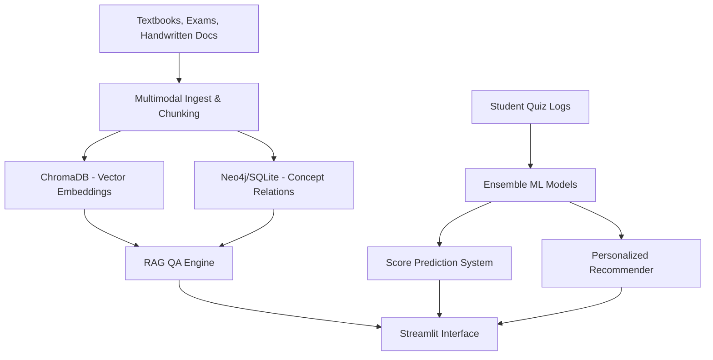

# EduGraphAI 🎓
> **Multimodal Educational Intelligence Platform for Personalized Learning**

EduGraphAI is an AI-powered educational intelligence platform that simplifies and customizes learning. By combining multimodal document parsing, Retrieval-Augmented Generation (RAG), Graph Databases (Neo4j/SQLite), and Ensemble Machine Learning models, the system constructs a dynamic and personalized educational path for students.

---

## 🚀 System Architecture & Flow



---

## 🛠️ Feature Overview

1. **Document Library**: Upload textbooks, notes, and slides (PDF, PPTX, Image, Text). Extract structured content, mathematical LaTeX formulas, and visual diagrams automatically.
2. **Ask EduGraphAI (RAG QA)**: Context-aware Q&A system returning precise answers cited from course materials alongside related math formulas and conceptual maps.
3. **Knowledge Graph Visualization**: Interactive concept dependencies and prerequisite learning pathways powered by Pyvis and graph engines.
4. **Handwriting Evaluator**: AI feedback on handwritten solutions, identifying conceptual, formula-based, and calculation errors step-by-step.
5. **Exam Intelligence**: Automated examination analyzer detailing high-frequency topics, derivations, and test patterns.
6. **Student Analytics & Score Predictor**: Real-time performance tracker with ensemble model score predictions, failure risk badges, and revision recommendations.

---

## 📊 Machine Learning Models & Metrics

The platform incorporates two advanced ensemble machine learning engines located under `backend/services/ml/analytics_service.py` to drive student analytics:

### Model A: Personalized Learning Recommendation System
* **Purpose**: Identifies conceptual vulnerabilities and recommends a prioritized study path.
* **Algorithm**: Ensemble of **Random Forest Regressor** and **XGBoost Regressor**.
* **Features**: Global student behavior profile (`avg_score`, `avg_time`, `avg_accuracy`), target subject index code, and target difficulty code.
* **Evaluation Metrics** (Trained on 100,000 synthetic student interaction attempts):
  | Model | Mean Absolute Error (MAE) | Root Mean Squared Error (RMSE) | R² Score |
  |---|---|---|---|
  | Random Forest Regressor | **6.44** | **8.07** | **0.787** |
  | XGBoost Regressor | **6.36** | **7.98** | **0.791** |
  | **Ensemble (Average)** | **6.37** | **8.00** | **0.791** |

### Model B: Student Performance Prediction System
* **Purpose**: Forecasts final exam grades, predicts pass probabilities, and assesses risk levels.
* **Algorithm**: Ensemble of **XGBoost**, **Gradient Boosting**, and **Random Forest Regressors** for score prediction, paired with an **XGBoost Classifier** for pass/fail classification.
* **Features**: Ingests historical quiz performance aggregates, scores, attempt difficulties, topic breadth, consistency score, and recent score trend.
* **Data Augmentation**: Augmented student record counts to **7,764 total profiles** using Gaussian perturbations to oversample tail performance distributions.
* **Evaluation Metrics**:
  | Metric | Value |
  |---|---|
  | **Ensemble MAE** (Regressor) | **6.09%** |
  | **Ensemble RMSE** (Regressor) | **8.35%** |
  | **Classifier Accuracy** | **93.74%** |
  | **Classifier Precision** | **94.38%** |
  | **Classifier Recall** | **96.92%** |
  | **Classifier F1-Score** | **95.63%** |
  | **Classifier Calibration** | Sigmoid score calibration applied |

---

## 💻 Installation & Setup

### Prerequisites
* Python 3.9+
* Node.js (optional, for custom bindings)
* Neo4j Database (Optional; system defaults to local SQLite graph mode if not available)

### 1. Install Dependencies
Clone the repository and install required python modules:
```bash
pip install -r requirements.txt
```

### 2. Configure Environment Variables
Create a `.env` file based on `.env.example`:
```bash
cp .env.example .env
```
Provide your API keys and databases credentials:
```env
GEMINI_API_KEY=your_gemini_api_key_here
NEO4J_URI=bolt://localhost:7687
NEO4J_USERNAME=neo4j
NEO4J_PASSWORD=your_password
```

### 3. Run the Backend API Server
Start the FastAPI server on port 8000:
```bash
.venv\Scripts\uvicorn backend.main:app --port 8000
```

### 4. Run the Streamlit Frontend App
Start the Streamlit client server:
```bash
$env:PYTHONPATH="."
.venv\Scripts\streamlit run frontend/app.py
```
Open **`http://localhost:8501`** in your browser to access the interface.
